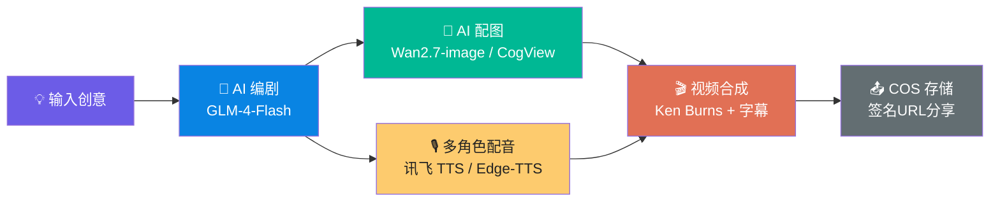

<div align="center">

# Shortify AI 🎬

[](LICENSE)
[](package.json)
[](package.json)
[](lib/ai/)
[](scripts/)


### ✨ 输入创意，输出成品 — AI 短剧创作平台

**从一行创意到完整短剧：AI 编剧 → 分镜配图 → 多角色配音 → 1080P 视频合成**

[🌐 在线体验](https://craftmind.cn) · [📖 功能介绍](#-功能特性) · [🚀 快速开始](#-快速开始)

---

</div>

## 📸 效果概览

> **一张图看懂 Shortify AI 的工作流：**



## 🎯 为什么做 Shortify AI?

短剧市场 2025 年规模超 500 亿元，但创作门槛极高：
- 🎭 **剧本** → 需要编剧能力
- 🎨 **分镜** → 需要美术/导演能力
- 🎙️ **配音** → 需要录音棚/配音演员
- 🎬 **剪辑** → 需要视频编辑软件

**Shortify AI 把这 4 步全部自动化。** 你只需要输入一个想法，其余交给 AI。

---

## ✨ 功能特性

### 🎭 AI 智能编剧
输入创意主题（如"古代丫鬟穿越到现代职场"），AI 自动生成：
- 结构化剧本（角色对话格式）
- 分镜头拆解（每个镜头包含角色、台词、场景描述）
- 旁白与对话混合编排

> 支持两个版本：V1 旁白式 / V2 角色对话式（推荐）

### 🎨 AI 分镜配图
- 单集配图 / 逐镜头配图
- 多种生图模型可选：Wan2.7-image、CogView-3-Plus、Wanx-v1
- **角色参考图一致性**：自动生成角色定妆照，万相 2.7 多图参考生成，跨镜头保持同脸
- 自动上传至腾讯云 COS（私有桶 + 签名 URL）
- 支持 16:9 横屏和 9:16 竖屏

### 🎙️ 多角色智能配音
- 自动识别剧本角色性别/身份 → 分配对应音色，**不同角色强制不同音色**
- **CosyVoice 情感配音**（优先使用）：LLM 为每个镜头标注情绪基调，驱动自然语言情感指令
- **声音复刻**：上传 10~20 秒人声样本，为角色生成专属音色
- **讯飞 TTS**（WebSocket）+ **Edge-TTS**（自动降级，音色智能映射不错乱）
- 角色一致性：同一角色全剧使用同一个 voiceId

### 🎬 1080P 视频合成
| 功能 | 说明 |
|------|------|
| **镜头语言（分镜级）** | 每个镜头带景别/机位/运镜/光线/转场；景别与机位写入生图提示词，运镜决定画面运动，转场逐镜头生效 |
| **Ken Burns 运镜** | 固定机位（静止）+ 推近/拉远/左右平移/上下摇/跟随；无运镜字段的历史作品回退到按镜头序号轮换 |
| **AI 视频生成** | 支持 Wan2.7-t2v / CogVideoX-3 等模型；画面描述 + 镜头语言写入提示词（台词仅作表情参考） |
| **对口型 Lip-sync** | 对白镜头可选接入可灵 lip-sync，配音驱动口型（`KLING_LIPSYNC=true`，消耗可灵算力） |
| **字幕烧录** | SRT → ASS，底部居中白色黑边，自动适配时长 |
| **BGM 背景音乐** | 上传自定义音乐，可调节音量混入配音 |
| **SFX 环境音效** | LLM 按镜头打音效标签，内置 ffmpeg 合成预设（雨/风/雷/心跳等）+ 自备音效库 `uploads/sfx-library/` |
| **视频质量** | CRF 18, preset medium, yuv420p, 1080P |
| **逐镜头转场** | 每个 junction 独立转场（硬切/淡入淡出/黑场/白场/溶解/滑入/圆形展开）；`cut` 先统一编码参数再拼接，避免采样率不一致 |

### 📤 导出与分享
- 腾讯云 COS 签名 URL → 一键下载
- 视频在线播放（浏览器/移动端均可）
- 公开分享链接
- 封面图自动生成（视频第一帧）

### 🛡️ AI 生成内容标识（合规）
依据《人工智能生成合成内容标识办法》（2024 年 3 月发布，**2025-09-01 施行**）实现双重标识，默认开启：

| 标识类型 | 落地方式 |
|------|------|
| **显式标识** | 成片画面固定角位（默认右上，避开底部字幕）烧录半透明底衬的「AI 生成」文案；字号/边距按视频高度比例缩放，横竖屏自适配 |
| **隐式标识** | mp4 元数据写入 `AIGC_*` 字段（生成合成确认状态、服务提供方、内容唯一编号、SHA-256 内容哈希与算法、标识版本、生成时间），经 `-movflags +use_metadata_tags` 落盘 |
| **溯源 sidecar** | 每个成片旁生成同名 `.aigc.json`，记录文案/角位/母版哈希与**标识后文件哈希**，便于校验链路完整性 |
| **展示面标识** | 公开分享页与作品页显示「AI 生成」徽标 |

```bash
AIGC_LABEL_ENABLED=true     # 总开关（默认 true）
AIGC_LABEL_VISIBLE=true     # 是否烧录可见标识（false 则仅写隐式元数据）
AIGC_LABEL_TEXT=AI 生成      # 可见标识文案
AIGC_LABEL_POSITION=top-right
AIGC_SERVICE_PROVIDER=Shortify AI
```

> **部署注意**：烧录中文依赖中文字体。镜像已安装 `font-noto-cjk`；若自建镜像，请安装中文字体或通过 `AIGC_LABEL_FONT` 指定字体路径，否则标识会回退为拉丁文案（不会渲染成方块字），字体完全缺失时降级为仅写隐式元数据并在日志报错。
>
> 元数据可被 `ffprobe` 读取核验（例如 `ffprobe -show_format output.mp4`）；但部分播放器/平台会忽略自定义 mdta 字段，这也是额外输出 sidecar 的原因。

### ⚙️ 平台功能
- 🔐 **NextAuth JWT 登录**（邮箱 + 密码）
- 💰 **积分系统**（注册送 200，各操作扣积分）
- 🎨 **12 种故事风格**（写实/动漫/水墨/赛博朋克等）
- 📱 **响应式设计**（移动端 + 桌面端完美适配）
- 📊 **创作看板**（进度跟踪、管理作品）
- 🗑️ **作品管理**（编辑/复制/删除）
- ✂️ **分镜编辑器**：单镜头改文案/情绪/时长/**镜头语言（景别·机位·运镜·光线·转场）**，按需重跑生图（1 积分）/ 配音 / AI 视频（20 积分）；AI 一键为全剧/单集批量补齐情绪、音效与镜头语言标注（老剧本无需重新生成即可升级）

---

## 🏗️ 项目架构

```
shortify-ai/
├── app/                          # Next.js 16 App Router
│   ├── api/generate/             # AI 生成 API
│   │   ├── script/               #   剧本生成
│   │   ├── storyboard/           #   分镜生成
│   │   ├── voiceover/            #   配音生成
│   │   └── video/                #   视频合成
│   ├── (dashboard)/              # 用户主界面
│   │   ├── dramas/               #   作品列表
│   │   └── create/               #   新建短剧
│   └── share/                    # 公开分享页
├── lib/ai/                       # AI 核心引擎
│   ├── glm-client.ts             #   智谱 GLM 调用
│   ├── script-generator.ts       #   剧本生成（含镜头语言字段）
│   ├── shot-prompts.ts           #   分镜提示词组装（角色外貌 + 镜头语言）
│   ├── shot-annotator.ts         #   存量分镜批量补齐情绪/音效/镜头语言
│   ├── image-generator.ts        #   图片生成路由（多图参考角色一致性）
│   ├── wan-image-generator.ts    #   阿里百炼生图
│   ├── video-generator.ts        #   视频生成路由
│   ├── wan-video-generator.ts    #   阿里百炼视频
│   ├── voiceover-generator.ts    #   配音生成（CosyVoice 情感 → 讯飞 → Edge）
│   ├── cosyvoice-tts.ts          #   CosyVoice 情感 TTS
│   ├── cosyvoice-clone.ts        #   声音复刻（Voice Enrollment）
│   ├── sfx-library.ts            #   音效标签解析与合成
│   ├── kling-client.ts           #   可灵对口型（JWT 鉴权）
│   ├── subtitle-generator.ts     #   字幕生成
│   ├── video-composer.ts         #   FFmpeg 合成（运镜 + 逐镜头转场）
│   ├── cos-storage.ts            #   腾讯云 COS
│   └── model-resolver.ts         #   模型配置解析
├── scripts/                      # 独立运行脚本
│   ├── full-pipeline.ts          #   全集一键生成
│   ├── test-shot-language.ts     #   镜头语言/转场映射冒烟测试
│   └── gen-pipeline.ts           #   分步生成
├── drizzle/                      # 数据库 Schema
└── uploads/                      # 本地文件缓存
```

---

## 🛠️ 技术栈

| 类别 | 技术 |
|------|------|
| **前端** | Next.js 16 (App Router) + React 19 |
| **UI** | Tailwind CSS v4 + shadcn/ui + Dark Mode |
| **数据库** | PostgreSQL + Drizzle ORM |
| **认证** | NextAuth.js v5 (JWT, Credentials) |
| **AI 编剧** | GLM-4-Flash / DeepSeek / Qwen |
| **AI 生图** | Wan2.7-image / CogView-3-Plus / Wanx-v1 |
| **AI 视频** | Wan2.7-t2v / CogVideoX-3 |
| **AI 配音** | CosyVoice 情感 TTS + 讯飞 TTS (WebSocket) + Edge-TTS |
| **视频合成** | FFmpeg (zoompan + concat + subtitles) |
| **存储** | 腾讯云 COS (私有桶 + 签名 URL) |
| **部署** | PM2 + Nginx (反向代理) |

---

## 🚀 快速开始

### 前置条件

```bash
# 必需
Node.js >= 18
PostgreSQL >= 14
FFmpeg >= 4.4

# 可选
# 讯飞语音合成 API（配音）
# 腾讯云 COS（云存储）
# 阿里百炼 API Key（Wan2.7 生图/视频）
# 智谱 API Key（剧本生成）
```

### 安装

```bash
# 1. 克隆
git clone https://github.com/ycbing/Shortify-AI.git
cd Shortify-AI

# 2. 安装依赖
npm install

# 3. 配置环境变量
cp .env.example .env.local
# 编辑 .env.local，至少配置 DATABASE_URL 和 GLM_API_KEY

# 4. 数据库迁移
npm run db:push

# 5. 启动开发服务器
npm run dev
```

访问 `http://localhost:3000` 🎉

### 环境变量说明

| 变量 | 必填 | 说明 |
|------|------|------|
| `DATABASE_URL` | ✅ | PostgreSQL 连接地址 |
| `NEXTAUTH_SECRET` | ✅ | JWT 加密密钥 |
| `GLM_API_KEY` | ✅ | 智谱 AI 密钥（剧本生成） |
| `DASHSCOPE_API_KEY` | ❌ | 阿里百炼密钥（生图/视频/情感配音） |
| `XUNFEI_APPID` | ❌ | 讯飞 TTS |
| `COS_SECRET_ID` | ❌ | 腾讯云 COS |
| `VIDEO_PROVIDER` | ❌ | wan / cogvideo（默认 cogvideo）|

---

## 🧪 一键全集生成

```bash
# 配置好环境变量后，直接运行：
npx tsx scripts/full-pipeline.ts

# 脚本会自动：
# 1. 从数据库读取剧本数据
# 2. 为每个镜头配音 + 生图
# 3. 合成单镜头视频
# 4. 拼接为完整剧集
# 5. 上传到 COS → 更新数据库
```

---

## 🗺️ Roadmap

- [x] AI 剧本生成（V2 角色对话格式）
- [x] AI 分镜配图（多模型支持）
- [x] 多角色多音色配音
- [x] 1080P 视频合成 + 字幕烧录
- [x] COS 云存储 + 签名 URL
- [x] Ken Burns 多运镜效果
- [x] 积分/额度系统
- [x] 在线分享
- [x] BGM 背景音乐
- [x] 角色参考图一致性（万相 2.7 多图参考 + 定妆照自动补建 + 一致性评分脚本）
- [x] 声音复刻（CosyVoice Voice Enrollment，角色专属音色）
- [x] 分镜编辑器 v1（单镜头文案编辑 + 生图/配音/视频按镜头重跑）
- [x] SFX 环境音效（LLM 标签 + ffmpeg 合成预设 + 自备音效库）
- [x] 对口型 Lip-sync（可灵 lip-sync API，对白镜头配音驱动口型，失败自动退回）
- [x] AI 批量标注（LLM 为存量分镜补齐情绪/音效标签，fill 模式不覆盖手改）
- [x] 镜头语言（景别/机位/运镜/光线/转场 分镜级字段 + 剧本产出 + 批量标注 + 逐镜头转场合成）
- [x] AI 生成内容标识合规（显式画面标识 + 隐式 AIGC 元数据 + 哈希溯源 sidecar + 分享页徽标）
- [ ] 主角 LoRA / IP-Adapter 训练管线（90%+ 一致性档）
- [ ] 批量创作模板
- [ ] 竖屏模式 (9:16)
- [ ] 分镜编辑器增强
- [ ] 多语言输出

---

## 🌐 友情链接

- [Linux DO](https://linux.do/) — 高质量技术社区

## 📄 许可证

MIT License — see [LICENSE](LICENSE)

---

<div align="center">

**Built with ❤️**

[](https://github.com/ycbing/Shortify-AI/stargazers)
[](https://github.com/ycbing/Shortify-AI/network/members)

</div>
